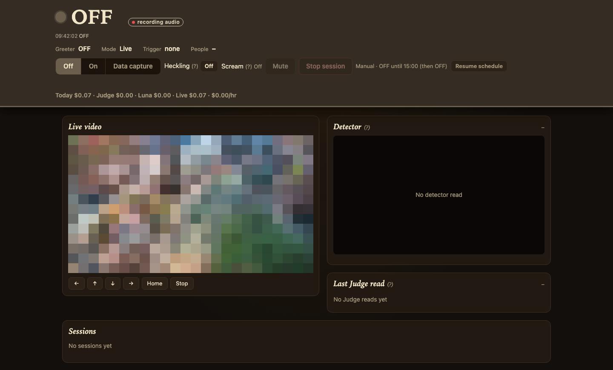

# The Banjo Porch

A talking Halloween porch greeter. A network IP camera watches the front yard; when trick-or-treaters walk up, "Cornelius", the ghost of an old-time banjo player who haunts the porch, greets them through a speaker, roasts their costumes and chats with them live. Built for one house's Halloween 2026 in a week, shared as-is.



**What it does**

- **Local person detection** (YOLOX-tiny in a Python sidecar, on the box): sidewalk / path / porch zones you draw on the camera image, ignore zones for props, a lightweight motion tracker (arriving / present / leaving, group counts). No identity, no face recognition.
- **Live voice** via Gemini Live (`VOICE_BACKEND=gemini`, recommended; `GEMINI_MODE=all-gemini`) or OpenAI GPT-Live. The character lives in `prompts/world-gemini.md`; the code only sends short stage cues ("someone is walking up the path", "they're at the porch now") and queues them so he is never cut off mid-sentence.
- **PTZ framing** over ONVIF (bounded pulses, saved home position).
- **Dashboard** on port 3031: live video with detector boxes, mode switch and daily schedule, sessions, costs, plus `/visits.html` (recorded visit clips with a speech timeline), `/zones.html` (draw zones), `/review.html` (label reads).
- **Visit clips and a replay harness**: every visit can be recorded (video + optional audio + timeline) and replayed through the real pipeline against a real or fake voice backend to test prompt and timing changes.
- Optional **sidewalk scream** (`scripts/scream/generate.mjs` renders TTS clips; `SCREAM=on`).

**Hardware it ran on**: a small Ubuntu 24.04 box, a TP-Link Tapo C520WS pan/tilt camera (RTSP + ONVIF), a USB speakerphone (Revolabs FLX UC 500) through PipeWire. Any RTSP camera works for watching; aiming needs ONVIF PTZ.

**Heard on Halloween night** (Cornelius's side only, from the 2026 transcripts; he blames his skeleton crew, Gus on the ladder, Lefty and Hedley, who are porch props):

> No costume? Bold choice. You've come as a person who thinks the candy is unconditional.

> A princess in a red sweater? My, the royal budget must be tight this year! Did you leave the tiara and the gown at the castle? Take a piece of candy, Your Highness!

> Clif Bars? Trying to stay in shape for haunting season, are we? My crew has no guts, so they can't digest that health food anyway.

> Skeleton Man? I've got more backbone than my whole crew combined! Take your candy and clear out before Gus drops on your head.

> A Grinch and a mouse, looks like a cartoon convention gone wrong!

And when asked to sing:

> A princess in red, but without her crown,<br>
> The fairest royal to haunt this town.<br>
> No gown or tiara, just a cozy knit sweater,<br>
> But for candy and heckles, there's no one better!

Full back-and-forth conversations (both sides, anonymous) are in [docs/HALLOWEEN-2026.md](docs/HALLOWEEN-2026.md).

## Quick start

Node 22+, ffmpeg, PipeWire CLI tools (`pw-play`, `pw-record`), Python 3 for the detector (see docs/DEPLOYMENT.md "Person detector").

```sh
npm ci
cp .env.example .env   # set CAMERA_URL, GEMINI_API_KEY (or OPENAI_API_KEY), AUDIO_MODE=linux ...
npm test               # all tests use fakes; no API calls, no camera
npm start              # http://localhost:3031
```

## Privacy

With the Gemini backend, camera video of visitors (including children) and porch audio are streamed to Google while someone is in the yard; with OpenAI, snapshots go to OpenAI. Put up a sign. Visit clips, transcripts and logs are stored locally under `data/` (gitignored); turn recording off with `VISITS=off` / `VISIT_AUDIO=off`. The character prompt is deliberately a no-holds-barred roast comic; tone it down for your crowd.

## License

MIT, see LICENSE.

---

The rest of this README and `docs/` are the original working notes from the deployment, lightly scrubbed. They describe one specific setup and include history.

## Run on the device

Install Node22+, ffmpeg, PipeWire command-line audio tools and the locked dependency with `npm ci`. Keep camera credentials and OPENAI_API_KEY in ignored server `.env`.

```sh
npm ci
npm start
```

Use **http://192.0.2.10:3031/** from the Mac. For standalone mode configure:

```dotenv
AUDIO_MODE=linux
AUTO_START=true
AUTO_TRACK=true
CAMERA_ROTATE=0
PTZ_INVERT_TILT=false
BIND_HOST=0.0.0.0
PUBLIC_ORIGIN=http://192.0.2.10:3031
PTZ_POSITION_PAN_DIRECTION=1
PTZ_POSITION_TILT_DIRECTION=-1
```

The real camera is a TP-Link Tapo C520WS at 192.0.2.20. Private CAMERA_URL supplies its RTSP stream. ONVIF_URL, ONVIF_USERNAME and ONVIF_PASSWORD enable aiming. CAMERA_HOME_FILE (default data/camera-home.json) saves the waiting position. Home uses bounded pulses with position feedback, and sessions return there when they end. OPENAI_ENV_FILE may reference a private file on the device; no Mac file is required. FFMPEG_PATH, PORT, LIVE_VOICE and SESSION_LIMIT_SECONDS are optional. The service must retain access to the PipeWire session after SSH logout; see docs/DEPLOYMENT.md.

## Pipeline

1. One persistent RTSP decoder supplies6fps live video at `/api/video` and the snapshots selected for analysis. The webpage flashes when a model snapshot is selected. Preview viewers do not create extra camera connections.
2. Decisions (`gpt-6-luna`) counts real visitors, controls bounded framing, classifies each person as sidewalk/path/porch (Live starts only once people are on the path) and counts arriving/present/leaving visitors in buckets, and checks up to three costume slots against50common costume ideas plus unknown/other/no-costume choices. Every reflective-vest figure is a prop. Active visitors/parties are checked at1Hz; empty-scene capture cadence remains adaptive. Actual cadence includes API latency.
3. Luna Responses receives a separate factual image prompt. It describes real clothing/costumes, never character jokes or voice instructions. Stable costume evidence or a porch fallback triggers the one costume-details message; ambiguous costumes become a question. A strict filter rejects prop-vest descriptions before any voice payload.
4. The native Linux Live session receives at most three distinct event prompts: immediate welcome/invitation, costume details, goodbye. No recurring image pushes or delegation replies. Goodbye includes a rotating dead joke near the deadline, and audio closes within60seconds. The same event cannot be sent twice. A completed party cannot immediately restart while the same guests remain.
5. Linux `pw-record`/`pw-play` stream24kHz monoPCM through Cinder. The Mac only monitors/controls. Ending a session closes audio first, returns the camera to its saved waiting position, and continues watching for the next party.

AUTO_START starts observation when the service listens, without a browser. AUTO_TRACK enables bounded framing initially and on a fresh zero-to-positive arrival. Each motor pulse is speed0.25 for350ms, camera-side1s timeout, then explicit Stop. Each framing attempt has30seconds/12pulses and a0.2 position range from its start. Mechanical limits are surfaced. Decisions must prioritize a full head with headroom over torso centering. Camera rotation affects all uploaded/displayed RTSP JPEGs. For the current upright outdoor mount, positive tilt velocity raises the view while reported tilt decreases; position polarity is configured separately from motor inversion.

## Controls and audit view

The webpage controls automatic voice, mute, framing, manual directions, Stop and saved Home. Live video is independent of model snapshot timing; manual movement refreshes the view immediately. Refresh scene is an explicit analysis request. Closing the page leaves automation running.

The last10 Luna Responses image queries appear newest first; the latest is expanded and its full prompt stays inside a collapsed detail. Each shows its exact original JPEG and result. Decisions entries are hidden from this view and remain available through the underlying debug API. Both history rings are memory-only and clear on restart. docs/VISION_PROMPTS.md records prompt templates; the page shows the exact per-request text including current image-analysis inputs.

Conversation text is saved to `TRANSCRIPT_DIR` (default `data/transcripts/`) on the device. Only text fragments and timestamp/session metadata are persisted; microphone/speaker audio and camera images are never saved by this store. The conversation selector browses prior sessions, shows grouped readable turns with timestamps and spoken-span duration, and downloads a plain text copy. Live voice continues normally. Storage errors are surfaced in the page.

Read-only APIs: `/api/transcripts`, `/api/transcripts/:id`, `/api/transcripts/:id/download`, `/api/transcripts/:id/events`, `/api/video`, `/api/video/status`, `/api/camera/status`, `/api/audio/status`, `/api/scene/latest`, `/api/vision/history`, `/api/ptz/status`, `/api/frame`. The session event panel links only the three triggering Decisions responses and exact Live prompts. Deadline/manual events are explicitly marked; routine camera queries are not persisted there. The collapsed Voice rehearsal panel sends welcome, sample pirate/witch/T.rex costumes, and goodbye while automation is paused.

POST controls: `/api/audio/rehearsal`, `/api/audio/start`, `/api/audio/stop`, `/api/audio/mute`, `/api/camera/start`, `/api/camera/stop`, `/api/framing/start`, `/api/framing/stop`, `/api/ptz` with an action. POSTs require the configured origin. This app is intended for the home LAN and has no public-user authentication.

## Verification

`npm test` exercises isolated injected transports, authoritative Decisions counts/cadence and absence timing, request bodies, secret exclusion, always-Stop motor behavior, pending-result cancellation, head clipping, Linux audio lifecycle/mute and standalone startup without any browser requests. No mock camera exists in production. The lead verified actual live-video bytes, Wi-Fi-only access, speaker/microphone streams, recorded two-way text, model motor commands and feedback Home. The revised three-event conversation still requires its live rehearsal before acceptance.

docs/COSTS.md holds the earlier event budget. Persistent cost logging is omitted at the user’s request (2026-10-25).

`PTZ_POSITION_PAN_DIRECTION` and `PTZ_POSITION_TILT_DIRECTION` independently configure whether logical right/up increases (`1`, default) or decreases (`-1`) the camera's reported position. Status exposes `position_pan_direction`/`position_tilt_direction` separately from motor signs. Mechanical limits use reported-position direction; `PTZ_INVERT_PAN/TILT` affects velocity only. Recalibrate both after physically remounting or changing image rotation.

docs/JOKES.md contains the approved standing bank and an unapproved appendix. Runtime reads only the approved section; deploy docs/JOKES.md alongside server.mjs.

## Source deployment

Canonical source on the device is `/home/<user>/halloween-source`, a sparse checkout of this repository. The enabled user service runs its `halloween-greeter/server.mjs` directly. Make and test changes in a local worktree, land on origin/main, then on the device run `git -C ~/halloween-source pull --ff-only origin main`, `npm ci` in its project directory, and `systemctl --user restart halloween-greeter`. Confirm `/api/status` deployment_commit matches the checkout HEAD; the webpage links this commit. Never patch remote tracked files or deploy an unmerged branch. Private .env, text data and saved camera position are ignored by Git.

## Replay a clip with a real voice on your Mac

```
bash -lc 'source ~/.bashrc; node scripts/replay/run.mjs --from http://192.0.2.10:3031 --clip 20261026-182115-91e4f6 --backend gemini --gemini-mode all-gemini --detections recorded --speaker --send-recorded-media --max-cost 0.25 --cleanup'
```

Pulls the clip over read-only HTTP, replays its video and mic track at real speed through the real pipeline against Gemini Live, plays the voice on your speakers, prints the transcript live and the cost at the end. Requires `--send-recorded-media` (the clip's frames and voices go to Google). See docs/DEPLOYMENT.md.
